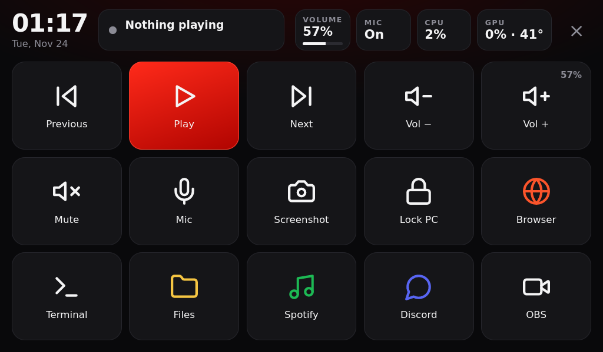
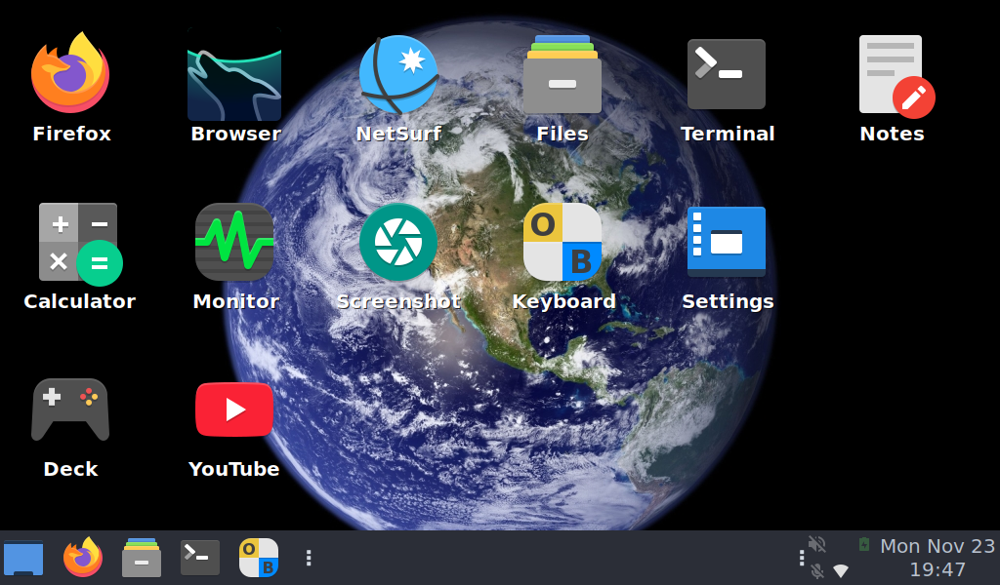

# Tab Deck

Turn an old tablet into a Stream Deck for your Linux PC.

The PC serves a touch control page; the tablet shows it full-screen. Tap a tile and the PC plays/pauses,
changes volume, mutes the mic, takes a screenshot, locks the screen or opens an app. A status bar shows
the clock, what's playing, volume, mic state and live CPU/GPU load.

<p align="center"></p>

Built for (and on) a **Samsung Galaxy Tab 3 Lite (SM-T111)** from 2014 running postmarketOS, so it is
light by design. The server is one Python file with no dependencies; the page is one HTML file.

## What's in here

| Path | What it is |
|---|---|
| `deck.py` | PC server: the button actions, a JSON API and the status feed (Python standard library only) |
| `deck.html` | The deck page: tiles, status bar, press feedback, live updates |
| `systemd/tabdeck.service` | Runs the server at login as a user service |
| `tablet/tabdeck.sh` | Tablet launcher: finds the PC over USB or Wi-Fi and opens the deck in Firefox kiosk mode |
| `tablet/youtube.sh` | YouTube on the tablet: search box, then the top result plays full-screen in mpv at 240p |
| `tablet/tabletui.sh` | Turns the MATE desktop into a tablet home screen: icon grid, bottom dock, dark theme |
| `tablet/kernel34-fixes.sh` | Fixes for the old 3.4 kernel: package repos, black screen after boot, Wi-Fi addresses |

<p align="center"></p>

## Buttons

Previous, Play/Pause, Next, Vol −, Vol +, Mute, Mic, Screenshot, Lock PC, Browser, Terminal, Files,
Spotify, Discord, OBS.

The PC side targets **KDE Plasma on Wayland** with **PipeWire**:

- media keys go through KDE's global shortcuts (`qdbus6 org.kde.kglobalaccel`), so they work with any
  player Plasma controls
- volume and mic use `wpctl`
- screenshots use Spectacle, lock uses `loginctl`
- GPU load comes from `nvidia-smi` (shows `–` without an NVIDIA card)

To change a button, edit its command in `ACTIONS` in `deck.py` and its label, icon and colour in
`TILES` in `deck.html`.

## Setup

### PC

```sh
git clone https://github.com/Rishit-Juneja/tabdeck ~/tabdeck
mkdir -p ~/.config/systemd/user
cp ~/tabdeck/systemd/tabdeck.service ~/.config/systemd/user/
systemctl --user daemon-reload
systemctl --user enable --now tabdeck
cat ~/.config/tabdeck/token   # created on first start; the tablet needs it
```

The server listens on port 8780. Every request must carry the token, so other devices on your network
can't press your buttons. Buttons only run the fixed commands in `ACTIONS`.

### Tablet

Any device with a browser can open `http://<pc>:8780/?t=<token>`. The scripts in `tablet/` are for a
postmarketOS tablet:

```sh
mkdir -p ~/.config/tabdeck ~/.local/bin
echo '<token from the PC>' > ~/.config/tabdeck/token
echo '<PC MAC address>'    > ~/.config/tabdeck/pc_mac   # only needed for Wi-Fi
cp tablet/tabdeck.sh ~/.local/bin/tabdeck
cp tablet/youtube.sh ~/.local/bin/youtube
chmod +x ~/.local/bin/tabdeck ~/.local/bin/youtube
sudo apk add firefox-esr mpv zenity py3-pip font-noto-emoji
sudo pip install --break-system-packages -U yt-dlp
sh tablet/tabletui.sh      # optional: the tablet home screen
```

The launcher tries the USB link first (postmarketOS USB networking puts the PC at `172.16.42.2`),
then Wi-Fi. On Wi-Fi it looks the PC up by MAC address, because the PC's DHCP address can change.
The × in the top right closes the deck.

## Tablet notes

The SM-T111 has a Marvell PXA986 and only runs an old 3.4 kernel, which shaped most of this:

- **Firefox, not a lighter browser.** WebKit browsers (Badwolf, Epiphany) need `PR_SET_NO_NEW_PRIVS`
  for their sandbox, which arrived in kernel 3.5, so they exit on start. Firefox ESR falls back and runs.
  NetSurf works too but has no JavaScript, so the deck would reload on every tap.
- **Keep packages matched to the image.** Installing current Alpine edge packages on the 2023 image
  mixes library versions and breaks things. `kernel34-fixes.sh` pins the repos to Alpine 3.19 /
  postmarketOS v23.12.
- **Black screen after boot.** The framebuffer isn't a DRM device, so elogind reports the seat as not
  graphical and LightDM waits forever. The fix turns off LightDM's `logind-check-graphical`.
- **Wi-Fi joins but gets no address.** NetworkManager's IP config never lands on `wlan0`, so a small
  boot script applies a static address whenever Wi-Fi is up.
- **YouTube** runs in mpv, not the browser: the CPU decodes 240p smoothly and struggles at 360p.

Installing postmarketOS on this tablet without TWRP (the Home key was dead and stock Android restores
its recovery on every boot) came down to partitioning the microSD on the PC, unpacking the rootfs onto
it and flashing the image's `boot.img` to the `KERNEL` partition with Heimdall.

## License

MIT
